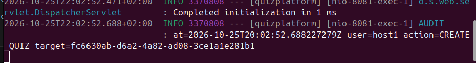
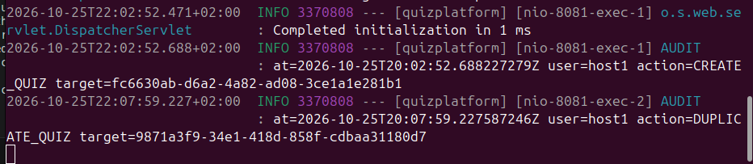
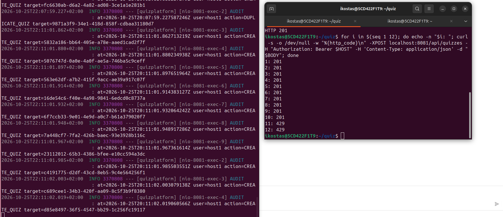
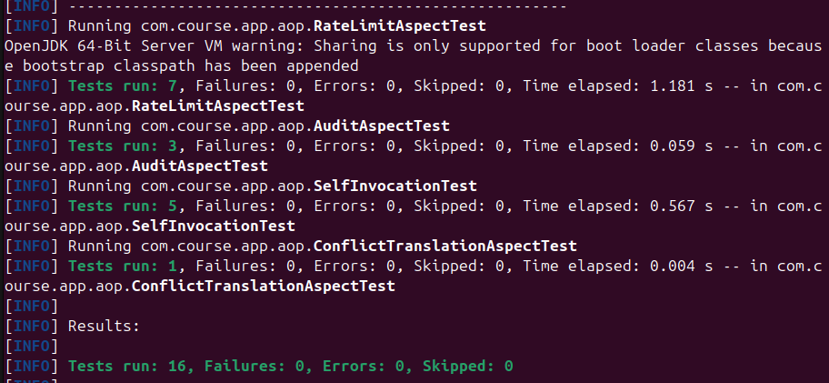

# Lab 4 — AOP (annotation + aspect pairs)

| Annotation | Aspect | Advice | Cross-cutting concern | Applied to |
|---|---|---|---|---|
| `@RateLimited(maxCalls, perSeconds)` | `RateLimitAspect` | `@Around` — decides whether `proceed()` is called; over the limit throws 429 | per-user sliding-window rate limit | `QuizService.create` (10 / 60 s) |
| `@Audited(action)` | `AuditAspect` | `@AfterReturning` — runs only on success | audit trail (who / what / which quiz) via `AuditLog` (logger `AUDIT`) | `create`, `update`, `delete`, `duplicate` |
| `@TranslateConflict` | `ConflictTranslationAspect` | `@AfterThrowing` — replaces `DataIntegrityViolationException` with 409 | exception translation | `create`, `update` |

## Screenshots

### 1. External call activates the aspect (`@AfterReturning`)
`POST /api/quizzes` goes through the Spring proxy, so `AuditAspect` runs and the application console shows an
`AUDIT` line: `user=host1 action=CREATE_QUIZ target=<quiz id>`.

### 2. Self-invocation does NOT activate the aspect (intentional)
`POST /api/quizzes/{id}/duplicate` creates a copy by calling `this.create(...)` inside `duplicate()`. Only one new
audit line appears — `DUPLICATE_QUIZ` (the proxy-entered method). There is no `CREATE_QUIZ` for the copy: the call
bypassed the proxy, so `create()`'s `@Audited`, `@RateLimited` and `@TranslateConflict` were silently skipped.
Compare with the `CREATE_QUIZ` line from the previous screenshot (same console, earlier request).

### 3. `@RateLimited` (`@Around`) blocks the call and never reaches the method
Twelve consecutive `POST /api/quizzes` calls by `host1` (limit 10 per 60 s). Requests 1–10 return `201` and each
produces an `AUDIT CREATE_QUIZ` line (left, console). Requests 11 and 12 return `429` and leave no audit line — the
advice did not call `proceed()`, so the target method did not run.

### 4. Aspect unit tests without Spring context
`RateLimitAspectTest` (7), `AuditAspectTest` (3), `ConflictTranslationAspectTest` (1) and `SelfInvocationTest` (5):
16 tests, 0 failures. The aspect tests use a mocked `ProceedingJoinPoint` (no `@SpringBootTest`) and assert whether
`proceed()` is called; `SelfInvocationTest` uses a real AOP proxy (`AspectJProxyFactory`) without a context or database.

