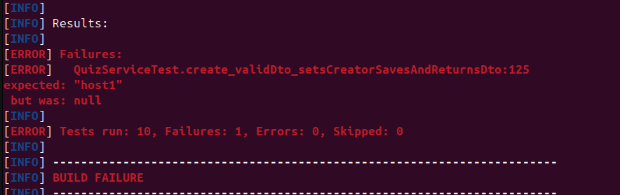
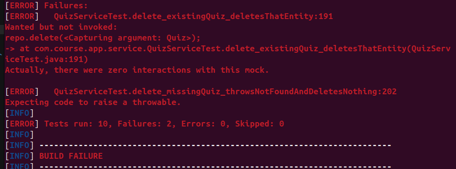

# AC4 — mutation evidence

Date: 2026-10-06. Command: `mvn test -Dtest=QuizServiceTest`. Each mutation is applied temporarily to `QuizService` and reverted afterwards.

## Mutation 1 — `create`: removed `quiz.setCreatedBy(username)`
```
[ERROR] Failures: 
[ERROR]   QuizServiceTest.create_validDto_setsCreatorSavesAndReturnsDto:125 
expected: "host1"
 but was: null
[INFO] 
[ERROR] Tests run: 10, Failures: 1, Errors: 0, Skipped: 0
```


## Mutation 2 — `delete`: removed `repo.delete(...)`
```
[ERROR] Failures: 
[ERROR]   QuizServiceTest.delete_existingQuiz_deletesThatEntity:191 
Wanted but not invoked:
repo.delete(<Capturing argument: Quiz>);
-> at com.course.app.service.QuizServiceTest.delete_existingQuiz_deletesThatEntity(QuizServiceTest.java:191)
Actually, there were zero interactions with this mock.

[ERROR]   QuizServiceTest.delete_missingQuiz_throwsNotFoundAndDeletesNothing:202 
Expecting code to raise a throwable.
[INFO] 
[ERROR] Tests run: 10, Failures: 2, Errors: 0, Skipped: 0

```


## After reverting both mutations
All 10 `QuizServiceTest` tests pass again (`git diff src/main` is empty).
